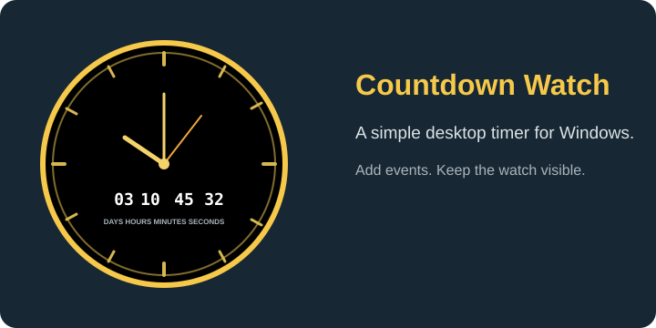

# Countdown Watch

A small Windows desktop countdown timer that stays on screen as a round watch.
Each event gets its own watch, with an analog face and a compact countdown for
days, hours, minutes, and seconds.



## What it does

- Starts with Windows through `start_countdown.vbs`.
- Restores saved events from `countdown_data.json`.
- Shows each countdown in a borderless circular watch.
- Moves the hour, minute, and second hands with the remaining time.
- Lets you add a countdown from the `+` control or by double-clicking a watch.
- Lets you remove a countdown with the `×` control.
- Supports dragging watches around the desktop.
- Opens an add/remove menu with a right-click.
- Shows a prompt when an event reaches zero.

## Requirements

- Windows
- Python 3.9 or newer
- Tkinter (included with the standard Windows Python installer)

No third-party Python packages are needed.

## Run it

From the project directory, run:

```powershell
python countdown.py
```

To start it without opening a console window, double-click
`start_countdown.vbs`. Create a shortcut to that VBS file in the Windows
Startup folder if the clock should launch when you sign in:

1. Press `Win + R`.
2. Enter `shell:startup`.
3. Put a shortcut to `start_countdown.vbs` in the folder that opens.

## Add and remove events

When no events are saved, click the `+ ADD EVENT` watch. When a countdown is
already visible:

- Click `+` in the lower-left corner to add another event.
- Double-click anywhere on the watch to open the add dialog.
- Click `×` in the lower-right corner to remove that event.
- Right-click the watch to choose **Add event** or **Remove event**.
- Drag the watch with the left mouse button to move it.

The add dialog accepts an event name, date, and 24-hour time. Dates in the
past are rejected. Events are written to `countdown_data.json` immediately.

## Files

| File | Purpose |
| --- | --- |
| `countdown.py` | Tkinter application and countdown/watch logic |
| `countdown_data.json` | Saved event list |
| `start_countdown.vbs` | Starts the app with `pythonw.exe` |
| `assets/countdown-watch.svg` | Project image used in this README |

## Notes

The watch is intentionally a small, always-visible utility rather than a
full-window application. The event name is used by the completion prompt and
the saved data, while the watch face stays uncluttered.

## License

No license has been selected yet. Add one before redistributing the project.
